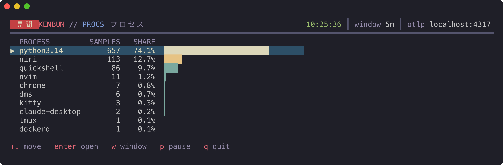
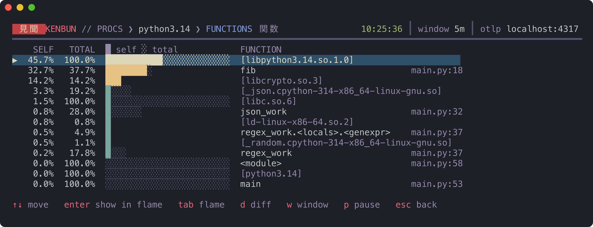
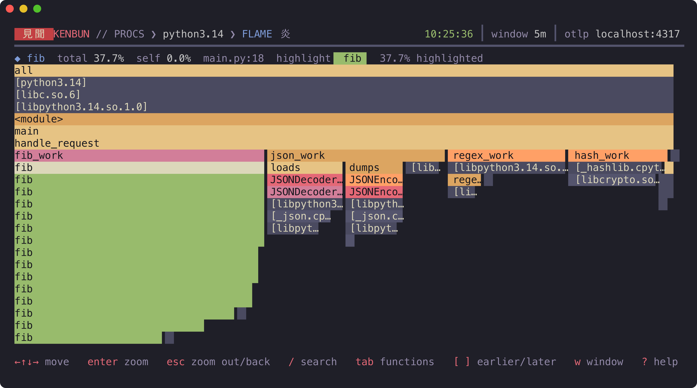
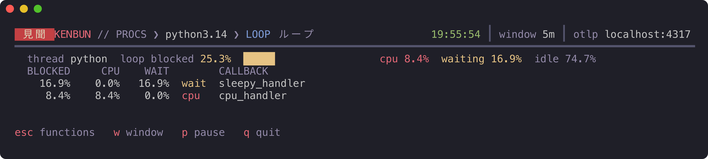

<p align="center">
  
</p>

<h1 align="center">kenbun</h1>

<p align="center">
  <em>見聞 · to see and to hear</em><br>
  OpenTelemetry profiles in your terminal: an embedded collector, an eBPF profiler, and a TUI.
</p>

<p align="center">
  
  
  
  
</p>

---

kenbun is a single binary that receives [OTLP profiles](https://opentelemetry.io/docs/specs/otel/profiles/),
keeps a sliding window of them in memory, and lets you read them where you already
work: the terminal. It can profile the machine it runs on with the
[OpenTelemetry eBPF profiler](https://github.com/open-telemetry/opentelemetry-ebpf-profiler),
deploy itself to a Kubernetes cluster, and tell you when a Python coroutine is
holding the asyncio event loop hostage.

- **Zero setup.** `sudo kenbun --profile` profiles every process on the machine, no instrumentation.
- **Any OTLP source.** An embedded OpenTelemetry Collector listens on `:4317`; point SDKs or other profilers at it.
- **Processes → functions ⇄ flame graph**, over a 30s–15m window you can pause, step back through and diff. `/` filters, `?` lists the keys.
- **Event loop blocking.** On- and off-CPU time tells you which callbacks block asyncio, and whether they burn CPU or wait.
- **Kubernetes in one command.** `kenbun k8s deploy` runs a profiler on every node and kenbun to collect it.

## 見 · What it looks like

Processes ranked by CPU over the window



A process's hottest functions, self and total; `d` diffs them against the previous window



The flame graph



And an asyncio event loop: how much of its time callbacks held it, and whether they computed or waited




## 始 · Quick start

Download a release (Linux or macOS, amd64 or arm64):

```bash
curl -fsSL https://github.com/adrijh/kenbun/releases/latest/download/kenbun_linux_amd64.tar.gz | tar -xz
sudo install kenbun /usr/local/bin/
```

Swap in `linux_arm64`, `darwin_arm64` or `darwin_amd64`. On macOS everything works
except `--profile` and `agent`, which need Linux. Or build from source (Go 1.27):

```bash
make build    # bin/kenbun
```

Profile this machine (Linux 5.10+, amd64 or arm64, root for eBPF):

```bash
sudo kenbun --profile
```

Or just receive profiles from your own OTLP senders. kenbun listens on
`localhost:4317`, or the next free port if that one is taken

```bash
kenbun
```

Keep a capture and read it later

```bash
sudo kenbun --profile --dump capture.jsonl
kenbun --file capture.jsonl
```

## 道 · Commands

Two ways to look at profiles, the TUI and one-shot queries, and one way to say
where they are:

| Command | |
|---|---|
| `kenbun [source]` | The TUI. |
| `kenbun top \| functions \| diff \| loop [source]` | One-shot answers for scripts and agents. See [Queries](#問--queries). |

| Source | Where the profiles are |
|---|---|
| *(none)* | This machine: the TUI collects them, and queries ask the kenbun running here. |
| `--k8s [--context c]` | The cluster's kenbun, through a `kubectl` port-forward. |
| `--addr host:port` | A kenbun elsewhere (`kenbun serve`). |
| `--file capture.jsonl` | A capture from `--dump`, offline (`.jsonl.gz` too). |

Collecting on this machine:

| Command | |
|---|---|
| `kenbun [--profile] [--otlp addr] [--dump file]` | Receive profiles (`--profile`: also run the eBPF profiler) and open the TUI. It also answers queries on `localhost:7070`, so an agent can ask about what you're watching. |
| `kenbun serve [--profile] [--otlp addr] [--dump file] [--http addr] [--db file]` | The same without the TUI, for headless boxes. `--db` keeps samples in a SQLite file instead of in memory. |
| `kenbun k8s deploy \| destroy \| manifests` | Set kenbun up on a cluster. See [Kubernetes](#船--kubernetes). |

The TUI writes its logs (and the collector's) to `$XDG_STATE_HOME/kenbun/kenbun.log`


## 問 · Queries

The TUI is for people. Scripts and AI agents get the same analysis as one-shot
commands that print a few lines of text, or JSON with `--json`:

```text
$ kenbun top --k8s --limit 4
all processes · last 5m · 174m CPU · 5066 samples

  CPU  SHARE  PIDS  PROCESS
  64m  36.7%        crio
  34m  19.5%        pmdalinux
  32m  18.6%        kubelet
   5m   2.6%     2  argo-cd/application-controller

$ kenbun loop python3.14 --since 1m
python3.14 · last 1m

thread python: loop blocked 25.3% (cpu 8.4%, waiting 16.9%), idle 74.7%

  BLOCKED   CPU   WAIT  KIND  CALLBACK
    16.9%  0.0%  16.9%  wait  sleepy_handler (/app/asyncio_demo.py:30)
     8.4%  8.4%   0.0%   cpu  cpu_handler (/app/asyncio_demo.py:35)
```

| Command | Answers |
|---|---|
| `top` | Which processes use the CPU, in millicores and share. |
| `functions <process>` | Where a process spends it: self (the function itself) and total (with its callees), with each function's hottest `file:line`. |
| `diff <process>` | What changed against the window before, in percentage points, biggest first. |
| `loop <process>` | Whether asyncio callbacks block the event loop, if they compute or wait, and on which line. |

Every query takes a [source](#道--commands), `--since` (default `5m`), `--limit`
(default `20`) and `--json`; `functions`, `diff` and `loop` take `--pid` for one
of a process's PIDs, which `top` counts and `top --json` lists. Without a source they ask the kenbun running on this
machine (`kenbun`, or `sudo kenbun serve --profile` headless). On a `--file`
capture, `--since` counts back from its end. The process name can come before or
after the flags. Sample counts are in every header: with a few dozen samples,
small shifts are noise.

The repo ships an agent skill, [`skills/kenbun`](skills/kenbun/SKILL.md), that teaches
an agent to investigate with these commands. For Claude Code, copy it into your
skills: `cp -r skills/kenbun ~/.claude/skills/`.

## 波 · asyncio loop blocking

A coroutine that calls `time.sleep()`, `requests.get()` or a blocking database
driver stops the whole event loop, yet barely shows up in a CPU profile: the
thread is asleep, not burning CPU. kenbun combines the eBPF profiler's on-CPU
samples with its off-CPU probe (time spent switched out, and where) and reads
each loop thread's stacks:

| Stack | Counts as |
|---|---|
| inside `Handle._run`, on CPU | **blocked, cpu**: the callback is computing |
| inside `Handle._run`, off CPU | **blocked, wait**: the callback sleeps or does blocking I/O |
| off CPU in `Selector.select` | **idle**: the loop has nothing to do |

Each blocking stack is charged to its callback: the first Python frame under
`Handle._run`, normally your handler coroutine. Waiting inside callbacks should be
close to 0%; move blocking calls to `asyncio.to_thread()` or an executor. CPU
inside callbacks is your actual work: keep each callback short.

Notes:

- Off-CPU time is sampled: the probe records 20% of context switches, so waiting
  shares are estimates that settle over longer windows. CPU shares are sampled
  steadily at 97 Hz.
- Off-CPU samples are kept only inside asyncio loops; elsewhere kenbun stays an
  on-CPU profiler.
- Needs CPython's pure-Python `asyncio` loop. uvloop runs its loop in compiled
  code, with no Python frames to read.

## 船 · Kubernetes

`kenbun k8s` drives `kubectl` with your kubeconfig and context; there is nothing
to install in the cluster beforehand.

```bash
kenbun k8s deploy --context my-cluster
kenbun --context my-cluster           # port-forwards and opens the TUI
kenbun top --context my-cluster       # or ask: see Queries
```

A release binary deploys the image of its own version. From source, publish a
matching image first: `make push` (to `ghcr.io/adrijh/kenbun:<git describe>`),
then `make build`.

If kenbun already runs there, which on a team usually means a teammate deployed it,
`deploy` asks first: attach to it (the default), update it (or restart it, on the
same version), or leave it. Updating restarts kenbun, so the last 30 minutes of
profiles are lost; it also warns before downgrading a newer kenbun. Without a
terminal (scripts, CI, agents) it just applies.

`deploy` creates a `kenbun` namespace with:

- **kenbun** (Deployment): `kenbun serve`, receiving OTLP on `kenbun.kenbun.svc:4317`.
  It keeps samples on disk (an `emptyDir`): 30 minutes of a whole cluster's profiles
  take gigabytes, far more than its memory limit.
- **kenbun-profiler** (DaemonSet): `kenbun agent` on every node, from the same image,
  so the Alpha profiles protocol always matches. It runs the eBPF profiler with
  off-CPU sampling and the collector's `k8s_attributes` processor.

Pods are named `service/container`, e.g. `argo-cd/redis`: Helm gives every
component of a release the same `service.name`, and the container tells them
apart. Processes outside pods keep their executable name.

The profiler needs nodes in the host PID namespace: real nodes, not k3d or kind
(deploy with `--profiler=false` there). `kenbun k8s destroy` removes everything.

## 構 · How it works

```text
 OTLP senders ─┐
               ├─▶ embedded OTel Collector ─▶ ingest.Convert ─▶ SQLite (in memory) ─▶ TUI
 eBPF profiler ┘    (otlp, profiling,          pprofile →        30 min retention      HTTP API
                     offcpu)                   kenbun samples
```

- **Collector.** kenbun embeds the OpenTelemetry Collector with the OTLP receiver,
  the eBPF profiling receiver and its off-CPU probe, a `file` exporter for `--dump`,
  and its own `kenbun` exporter. Config is YAML layered from flags (`otel.yaml`,
  `agent.yaml`).
- **Ingest.** Each OTLP batch becomes plain samples: time, process, thread, on/off
  CPU, frames (leaf first) and weight. kenbun's own processes are skipped.
- **Native names.** The profiler names Go, Python and kernel frames, but sends
  C, C++ and Rust code as an address in a binary. kenbun names those from the
  symbols on this machine, never over the network: the debug file of the binary's
  `-debug`/`-dbgsym` package (in `/usr/lib/debug`) if it's installed, else the
  functions the binary exports. A file is used only if its build ID matches, so
  profiles from other machines stay `[libfoo.so]` rather than get wrong names. For
  full names of a library, install its debug package (on Arch, enable the
  `core-debug` and `extra-debug` repositories).
- **Store.** Portable SQL through `database/sql` on a pure-Go SQLite. The database
  filters and sums; self/total, flame trees and loop analysis happen in Go. Samples
  older than 30 minutes and the stacks nobody uses any more are pruned every 30s.
- **API.** `kenbun serve` (and the local TUI, on `localhost:7070`) exposes the store over HTTP, and the TUI reads it the same
  way it reads the local store:

  ```text
  GET /api/processes?from=&to=                     → processes by on-CPU weight, with their PIDs
  GET /api/stacks?process=&pid=&from=&to=          → on-CPU stacks
  GET /api/threadstacks?process=&pid=&from=&to=    → stacks per thread, on and off CPU
  ```

  Times are unix nanoseconds, ranges are `[from, to)`.

## 作 · Development

```bash
make build    # bin/kenbun
make test     # go vet + go test
make image    # local image for this machine's arch
make dist     # release archives for every platform, in dist/
```

Releases come from tags: `git tag v0.1.0 && git push --tags` runs
`.github/workflows/release.yml`, which tests, attaches `make dist` to a GitHub
Release and pushes the image as `v0.1.0`.

Tests run on real captures in `internal/ingest/testdata/`: a CPU-heavy Python app
(`profiles.jsonl`) and the asyncio demo under `--profile` (`asyncio.jsonl.gz`).
`inspect_profiles.py` summarizes any `--dump` file independently of kenbun, which
is how the expected numbers were checked.

`make screenshots` regenerates the images above from the same fixtures, rendering
the TUI's real output with [freeze](https://github.com/charmbracelet/freeze).
